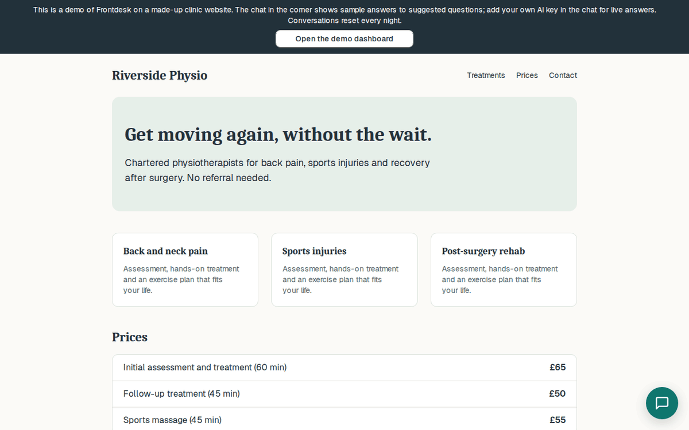

# Frontdesk

[](https://github.com/ToukirOfficial/frontdesk/actions/workflows/ci.yml)
[](LICENSE)

A free, open-source, self-hosted AI receptionist for small business websites. It answers visitors’ questions from the business’s own information, takes enquiries, books appointments and hands over to a person when it isn’t sure.

**[Try the live demo →](https://frontdesk.toukirahmedrony.com/demo)** It replays recorded sample answers, or you can use your own key for live answers.



**Bring your own key:** works with Anthropic, OpenAI, Gemini or any OpenAI-compatible endpoint, including self-hosted models with Ollama. The project ships no AI model and pays for none: you (or each business) add a key, and the provider bills you directly. With no key at all, Frontdesk still starts and everything except AI answers works.

## Contents

- [What it does](#what-it-does)
- [Why it exists](#why-it-exists)
- [Add the widget to a website](#add-the-widget-to-a-website)
- [Self-host with Docker](#self-host-with-docker)
  - [AI providers](#ai-providers)
- [The public demo](#the-public-demo)
- [How answers stay grounded](#how-answers-stay-grounded)
- [The evaluation set](#the-evaluation-set)
- [Architecture](#architecture)
- [Hard problems and decisions](#hard-problems-and-decisions)
- [Security](#security)
- [Tests](#tests)
- [Local development](#local-development)
- [Licence](#licence)

## What it does

- **Answers from your information only.** Add FAQs, pages of text (prices, services, policies), PDF or Word files, or import your website. Business details (address, opening hours, phone, booking link) are always known. Answers can show the sources they used.
- **Says “I don’t know”** instead of guessing, offers to take a message or find a person, and lists the question under **Unanswered**, so you know what to add.
- **Follows your rules** in plain English (“Never give legal advice; offer a consultation instead”), with presets for law firms, clinics and general businesses.
- **Takes enquiries** in the chat (with consent) and emails them to you.
- **Books appointments**: shows your booking link, or offers real free times from [Slotwise](https://github.com/ToukirOfficial/slotwise) and books one.
- **Live handover:** your team sees conversations as they happen and can take over. The visitor sees “You’re now chatting with Sam”. If nobody’s online, it takes a message instead.
- **Bring your own key:** each business adds its own provider, model and key under **AI provider** (stored encrypted, never shown again except the last 4 characters, never logged, with a **Test key** button). A self-hoster can also set one key for everyone in `.env`; a workspace’s own key wins. With no key, the chat says “No AI provider configured” and offers to take a message, and the dashboard shows how to add one.
- **Keeps costs in check:** rate limits per visitor, per IP and per workspace, and a monthly AI limit per workspace. At the limit, the chat takes messages only.
- **One script tag** on any site (WordPress, Laravel, plain HTML). The widget is a Web Component with Shadow DOM, so your CSS can’t break it. It works on phones, with a keyboard and with screen readers.

## Why it exists

Small businesses (clinics, solicitors, salons, cleaners, tutors) answer the same questions all day, and questions asked out of hours become lost customers. Paid AI chat tools cost a monthly fee, keep the data on someone else’s servers and often make things up. Frontdesk is the free alternative you host yourself, and it only answers from what you’ve given it.

## Add the widget to a website

In the dashboard, open **Assistant → Website widget** and copy the two lines:

```html
<frontdesk-chat key="fd_pk_…"></frontdesk-chat>
<script src="https://your-frontdesk.example/widget.js" defer></script>
```

On WordPress, paste them into a Custom HTML block or your theme’s footer. List your site under **Websites allowed to show the chat** so other sites can’t show your chat. That stops browsers, not scripts, which is why rate limits apply as well.

## Self-host with Docker

You need Docker and a server with about 2 GB of RAM.

```bash
git clone https://github.com/toukirofficial/frontdesk && cd frontdesk
cp .env.example .env
# Fill in: JWT_SECRET, CODE_SECRET, ENCRYPTION_KEY (openssl rand -hex 32 each),
# SMTP_URL (for login codes) and WEB_URL (your public address).
# Optional: AI_PROVIDER, AI_MODEL, AI_API_KEY to give every workspace your key.
docker compose up -d
```

This runs PostgreSQL (with pgvector), Redis, the API, the background worker and the web app. Open port 8025 (or put your own HTTPS proxy in front of it, passing WebSocket upgrades). Migrations run when the API starts. For a public demo, set `DEMO_MODE=true`. That seeds a fictional physio clinic at `/demo`, switches off sign-up, applies strict limits, sends no emails and resets every night (see [the demo](#the-public-demo) below).

### AI providers

Nothing here is required. Without any of it, each workspace adds its own key in the dashboard.

| `AI_PROVIDER` | `AI_MODEL` | `AI_API_KEY` | `AI_BASE_URL` |
|---|---|---|---|
| `anthropic` | a Claude model id | your Anthropic key | — |
| `openai` | an OpenAI model id | your OpenAI key | — |
| `gemini` | a Gemini model id | your Google AI Studio key | — |
| `openai-compatible` | the model name on that server | if it needs one | e.g. `http://localhost:11434/v1` (Ollama) |

There is deliberately no default model: write the id exactly as your provider’s docs do. Gemini and OpenAI-compatible endpoints use the `openai` client with a different address. A model without tool support still answers, just without sources or “unanswered” tracking. A workspace’s own OpenAI-compatible address must be reachable on the public internet (private addresses are refused, against SSRF). Only your `.env` may point at `localhost`.

## The public demo

The demo costs the host nothing, and it’s honest about how:

- **By default it replays recorded answers.** Visitors pick from suggested questions, and the answers come from a fixed set in `apps/api/demo/replay.json`, labelled **“Demo: sample answers”** on every reply. It isn’t answering live, and it says so. Typing free text isn’t offered. The current set was written by hand from the demo clinic’s knowledge. Re-record it from any provider with `pnpm --filter @frontdesk/api demo:record` (it uses the same prompts and retrieval as the app).
- **“Use your own key”** in the chat gives live answers about the demo clinic, paid by the visitor. The key is tested with one tiny request, stored encrypted against that one chat, never shown again or logged, and deleted after 24 hours (and at the nightly reset). Strict rate limits apply.
- Everything else is real: the dashboard, knowledge, enquiries, unanswered questions and live handover.

The API image is about 1.8 GB, mostly the local embedding runtime (free embeddings on your own server, no API key). Building behind a TLS-inspecting proxy? Pass its CA certificate: `docker build --secret id=ca,src=ca.crt …`.

## How answers stay grounded

1. Your knowledge is split into ~900-character chunks and embedded in the background (a local model by default, or OpenAI), then stored in PostgreSQL with pgvector.
2. For each question, the 5 nearest chunks **from that workspace only** are retrieved. Filtered vector search is subtle; see [decision 0001](docs/decisions/0001-filtered-vector-search.md).
3. The prompt has fixed instructions (answer only from the reference data, never invent prices or policies, say so when you don’t know) plus your preset and rules. Business details and the chunks follow, wrapped as **untrusted data**, so text inside a document or web page can’t give the assistant orders ([decision 0002](docs/decisions/0002-grounding-and-prompt-injection.md)).
4. The model signals gaps and sources with tool calls (`report_unanswered`, `cite_sources`), not wording the app has to guess at.
5. Answers stream word by word over WebSockets ([decision 0003](docs/decisions/0003-realtime-and-handover.md)).

Which provider answers is decided per message: the workspace’s own key, else the server’s key from `.env`, else none ([decision 0004](docs/decisions/0004-bring-your-own-key.md)). Prompts live in versioned files in `apps/api/prompts/`.

## The evaluation set

`evals/cases.json` holds 26 questions about the fictional demo clinic and a fictional law firm, each with the expected behaviour:

- correct answers from the knowledge (prices, hours, policies),
- an honest “I don’t know” for things that aren’t there,
- refusing medical and legal advice (and pointing to 999 in an emergency),
- resisting prompt injection, directly from the visitor and indirectly from a knowledge document.

It runs against whichever provider you set in `.env` (`AI_PROVIDER`, `AI_MODEL`, `AI_API_KEY`, and `AI_BASE_URL` for Ollama and friends), so you can compare models, including local ones:

```bash
pnpm build && pnpm eval        # all cases, your provider (your key, your cost)
pnpm eval --small              # 6 cases
pnpm eval --dry                # no API calls: checks the set and prompts build (what CI runs)
```

**Latest score:** not measured yet. The project has no AI key of its own. Run `pnpm eval` with yours and the result, including the provider and model, is saved to `evals/results/latest.json`.

## Architecture

```
apps/web          Next.js: the dashboard, the landing page and the /demo page; proxies /api to the API
apps/api          NestJS + Prisma: the HTTP API and WebSocket gateways (src/main.ts), and the BullMQ
                  worker (src/worker.ts) for embedding, website import, file parsing, email and nightly jobs
packages/shared   Zod schemas and types, shared by both apps
packages/widget   The <frontdesk-chat> Web Component, built to one file (widget.js)
evals/            The evaluation set (cases.json) and its runner (run.mjs)
```

**A visitor’s question:** widget → WebSocket (Socket.IO) → NestJS → retrieval of the 5 nearest chunks from that workspace in PostgreSQL/pgvector → AI provider (the workspace’s key, else the server’s) → the answer streamed back over the same socket.

| Choice | Why |
|---|---|
| **pgvector in PostgreSQL**, not a separate vector database | One database to run and back up on a small server. Every search filters by workspace, using iterative index scans so the filter still returns k results ([0001](docs/decisions/0001-filtered-vector-search.md)). |
| **Tool calls for “I don’t know”** (`report_unanswered`, `cite_sources`) | Gaps and sources are structured signals, never guessed from the answer’s wording. The model has only these two harmless tools ([0002](docs/decisions/0002-grounding-and-prompt-injection.md)). |
| **WebSockets with the Redis adapter** | Handover needs both directions and presence. The adapter lets any API instance reach any conversation, and “online” is just a staff socket in the workspace’s room ([0003](docs/decisions/0003-realtime-and-handover.md)). |
| **A Web Component widget** with Shadow DOM | One script tag and one HTML tag on any site. The host page’s CSS can’t break it, and it can’t leak styles out. |
| **Bring your own key** | The project pays for no AI. Each business uses its own provider and model, with keys encrypted at rest. With no key, everything except AI answers still works ([0004](docs/decisions/0004-bring-your-own-key.md)). |

## Hard problems and decisions

- **Filtered vector search can silently return nothing.** An HNSW index plus a workspace filter drops results when other workspaces hold closer chunks. Frontdesk uses pgvector 0.8’s iterative scans. On older pgvector (e.g. 0.6 from Ubuntu’s package, as on the live demo) it detects the version and falls back to an exact search of that workspace’s chunks automatically ([0001](docs/decisions/0001-filtered-vector-search.md)).
- **Indirect prompt injection** from imported pages and documents ([0002](docs/decisions/0002-grounding-and-prompt-injection.md)).
- **SSRF.** Website import and Slotwise fetch addresses typed by admins. Every fetch resolves DNS itself, refuses private, loopback, link-local and cloud-metadata addresses (IPv4 and IPv6), connects to the vetted IP, follows no redirects, and has a timeout and a size limit (`apps/api/src/net/safe-fetch.ts`).
- **Two people taking over the same chat** is one conditional database update; exactly one wins ([0003](docs/decisions/0003-realtime-and-handover.md)).
- **Multi-tenancy everywhere:** every query, every vector search and every socket room is scoped to a workspace. Another workspace’s ids return “not found”.

More small decisions are in [ASSUMPTIONS.md](ASSUMPTIONS.md).

## Security

- Logins need a password **and** a 6-digit code emailed every time. Passwords are hashed with argon2id. Sessions use short-lived httpOnly cookies, and refresh tokens are rotated on every use, with reuse detection.
- Every endpoint is closed unless it says who may call it (a test enforces this). Every query, vector search and live socket room is scoped to one workspace. Removed team members lose live access at once.
- AI keys and Slotwise keys are encrypted at rest and never returned or logged.
- Admin-typed addresses (website import, Slotwise, OpenAI-compatible endpoints) go through an SSRF guard. Uploads are checked by content, stored outside public folders, and Word files are checked for zip bombs before they're read.
- Rate limits cover login, codes, password reset, chat, enquiries, invites and workspace creation. Emails only go to addresses proven by a login code, so the server can't be used to send messages to strangers.
- Strict security headers on the dashboard (Content-Security-Policy, no framing, HSTS over HTTPS). Dependencies are updated weekly by Dependabot, and CI actions are pinned to exact commits.

**Found a vulnerability?** Please don’t open a public issue. Report it privately through GitHub’s **Security → Report a vulnerability** on this repository, and you’ll get a reply as soon as possible.

## Tests

```bash
pnpm typecheck && pnpm lint && pnpm test && pnpm build
```

147 API tests run against real PostgreSQL and Redis, with a fake AI provider. In tests every provider is the fake one, so no test or CI run can call a real API or need a key. They cover: login with emailed codes, refresh-token rotation and reuse detection, every role and permission, workspace isolation (including vector search across workspaces), rate limits, the monthly spend cap, live handover (including two simultaneous takeovers), SSRF protection, uploads, encryption of stored keys, retention, demo mode, and bring your own key: the app boots with no key, workspace keys are never returned by the API or written to logs, demo keys expire and are deleted, and a workspace can never use another workspace’s key. A test also fails if any endpoint forgets to say who may call it.

## Local development

You need Node.js 24, pnpm and Docker. No AI key is needed.

```bash
docker compose up -d postgres redis
cp .env.example .env              # fill in the three secrets (openssl rand -hex 32); AI settings optional
pnpm install
pnpm build                        # builds the shared package, widget and Prisma client once
pnpm --filter @frontdesk/api migrate
pnpm dev                          # web on http://localhost:8025, API on :8125, plus the worker
```

Without `SMTP_URL`, your login code is written to `apps/api/tmp/mail/`. Seed the demo clinic with `pnpm --filter @frontdesk/api seed:demo`.

## Licence

AGPL-3.0

Built by [Toukir Ahmed Rony](https://toukirahmedrony.com).
